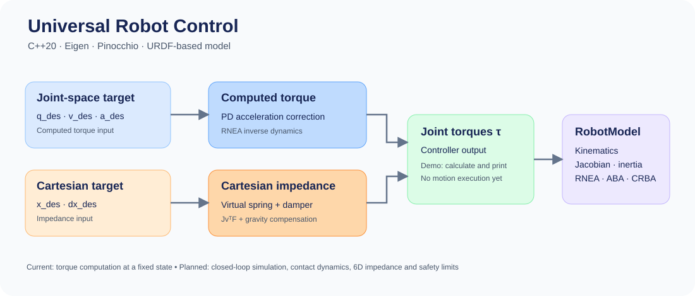

# Universal Robot Control

A modular **C++20** framework for model-based robotics using **Pinocchio** and **Eigen**.



## Implemented

- **RobotModel:** URDF loading, kinematics, frame Jacobians, mass matrix (**CRBA**), inverse dynamics (**RNEA**), and forward dynamics (**ABA**).
- **ComputedTorqueController:** Joint-space PD feedback with inverse-dynamics torque calculation.
- **CartesianImpedanceController:** 3D end-effector spring–damper control using Jacobian-transpose torque mapping and gravity compensation.
- **Demo:** Prints robot properties and torque commands from both controllers; existing GoogleTest dynamics suite.

## Build and run

From this directory, with Pixi dependencies installed:

```bash
cmake -S . -B build -G Ninja \
  -DCMAKE_BUILD_TYPE=Debug \
  -DCMAKE_CXX_FLAGS_DEBUG="-O0 -g0" \
  -DCMAKE_PREFIX_PATH="$PWD/.pixi/envs/default"
cmake --build build --parallel 1
./build/urc_demo models/arm6/arm6.urdf
```

## Next steps

Closed-loop simulation, gain tuning, 6D impedance, damped least-squares IK, MuJoCo contact tasks, and real-time benchmarking.

> **Status:** Early simulation-oriented prototype. The current demo computes torques but does not move the robot. Not safety-validated for physical hardware.
